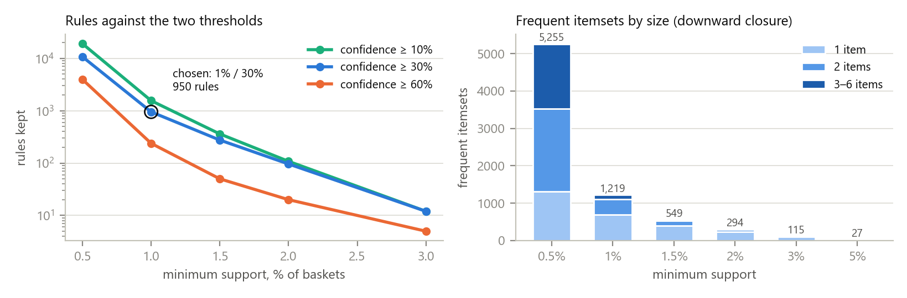
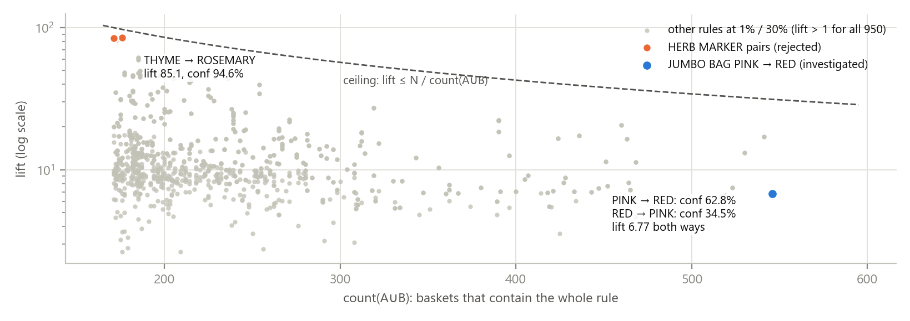
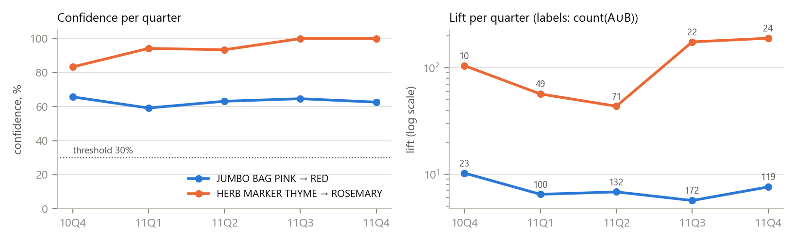
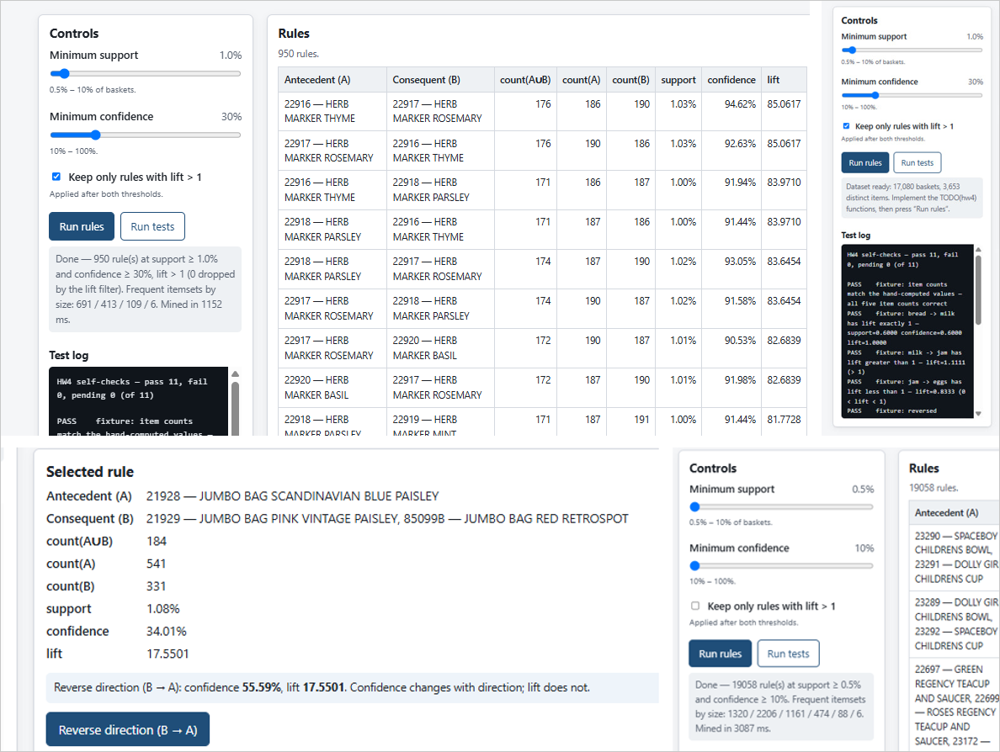

# Lift Rewards Rarity: Association Rules on UCI Online Retail, Checked Against Time

Student: Aleksei Kosychev &nbsp;&nbsp; Team: Individual 
Email: amkosychev@edu.hse.ru &nbsp;&nbsp; Date: 2026-10-08 
Assignment: A04 — Association Rules, UCI Online Retail (Week 4)

## Abstract

The Week 4 starter is a page with seven TODO stubs: basket deduplication, itemset counting, the three
metrics, a frequent-itemset miner and the rule generator. I implemented them as Apriori with
bitset counting, and checked every rule the page produces against an independent FP-Growth
implementation at 24 threshold settings — identical counts, identical metrics. At the chosen thresholds
(support 1%, confidence 30%) the page keeps **950 rules**, every one with lift above 2.6: no single item
reaches 12% of baskets, so any rule with confidence over 30% clears lift > 1 automatically, and that
filter removes only 2 rules anywhere on the sliders. **The rule at the top of the table is the one to
reject**: HERB MARKER THYME → ROSEMARY has lift 85 and confidence 95%, but it is one six-piece product
line bought as a set, and its lift is 95% of the ceiling N/max(count) that any two rare items reach. The
rule worth investigating is JUMBO BAG PINK POLKADOT → JUMBO BAG RED RETROSPOT: the most frequent pair in the
data (546 baskets), confidence 62.8% one way and 34.5% the other. Because the cleaned baskets turned out
to reproduce the raw UCI log exactly, every basket got its real date back, and the rules could be tested
on a later period rather than argued about: 92% of the rules mined on Dec 2010–Aug 2011 keep confidence
≥ 30% in Sep–Dec 2011, but only 27.5% keep 1% support — and the herb-marker rule is one that does not.

*Index Terms* — association rules, Apriori, FP-Growth, support, confidence, lift, market basket analysis

## 1. Introduction

**Problem statement.** The course provides a page and a cleaned export of the UCI Online Retail log
[1], [2]: 17,080 baskets (one per `InvoiceNo`) over 3,653 items (`StockCode`, labelled by
`Description`). The assignment asks to (i) build the invoice–item baskets, mine frequent itemsets with
Apriori or FP-Growth and generate rules with support, confidence and lift; (ii) state and justify the
thresholds and keep rules with lift > 1; and (iii) present one rule worth investigating and one to reject
with their counts, then discuss rule direction, the threshold trade-off, validation on a later period
and association versus causation.

**Concrete example.** Sorted by lift, the page's first two rows are HERB MARKER THYME → ROSEMARY and its
reverse: lift 85.06, confidence 94.6% and 92.6%. A reading that trusts the sort order would put a
cross-sell widget there. Yet 176 of the 186 baskets with thyme already contain rosemary, so the widget
could change at most 10 baskets in a year. The pair with the most evidence, JUMBO BAG PINK → RED (546
baskets), sits 834th of 950 by lift (Fig. 2).

**Contributions.** (i) The seven stubs, with a miner that answers the default thresholds in
0.5–1.2 s in the browser. (ii) A browser test of 24 checks, including equality with mlxtend's FP-Growth [7]
at every stored setting and with brute force on the five-basket fixture. (iii) An exact reproduction
of the course's cleaning from the raw workbook, which turns the "no usable timestamps" limitation into a
real out-of-time test. (iv) A citation correction: the starter attributes the dataset paper to the
*Journal of Cases on Information Technology*; it was published in the *Journal of Database Marketing &
Customer Strategy Management* [2].

## 2. Related Work

Association rules and support/confidence come from Agrawal, Imieliński and Swami [3]; Apriori and its
downward-closure pruning from Agrawal and Srikant [4]; FP-Growth, which mines without candidate
generation, from Han, Pei and Yin [5]; lift (there called *interest*) from Brin et al. [6]. Tan, Kumar
and Srivastava [8] compare interestingness measures and show that lift favours rare itemsets, which is
exactly what Section 4 observes. The reference implementation is mlxtend 0.25 [7]; the dataset is the UCI
Online Retail log [1] introduced by Chen, Sain and Guo [2]; the browser test uses Playwright [9].

**Alternatives considered.** *FP-Growth in the page*: the assignment allows either; Apriori with bitsets is
shorter, its pruning step is the downward-closure argument the threshold question asks about, and
FP-Growth is used where independence matters — as the reference. *Conviction or leverage instead of lift*:
both are in [6], [8], but the assignment fixes the three metrics; the lift ceiling below is the reason one
would want them.

## 3. Method

**Baskets and counting.** `dedupeBasket` keeps the first occurrence of each stock code, so a basket is a set.
`countItemset` intersects the provided inverted index, walking the shortest posting list and probing the
rest. The metrics return `{value, defined}` and are undefined, never `NaN` or `Infinity`, on a zero
denominator; the detail panel then prints "undefined" next to the starter's inline note.

**Miner.** `findFrequentItemsets` is Apriori: level k+1 joins two k-itemsets that share their first k−1
items (the level is kept sorted, so these sit together), then drops any candidate with an infrequent
k-subset. Counting is vertical: each stock has a bitset of the baskets containing it, and a candidate's
count is the popcount of its two parents' AND — 534 words instead of a pass over 17,080 baskets. The
threshold is inclusive, `count ≥ ⌈minSupport·N⌉`, i.e. 171 baskets at 1%.

**Rules.** `generateRules` emits every split of every frequent itemset into non-empty A and B, so both
`A → B` and `B → A` are generated; count(A) and count(B) are looked up among the frequent itemsets, which
downward closure guarantees to contain them. Rules are sorted by lift, then confidence, then evidence. A
checkbox applies lift > 1 after both thresholds, and the status line reports the itemsets per size and
the mining time. The starter's comment that reversing a rule changes its support was corrected: support,
like lift, is symmetric.

**Dates from the raw log.** The export has no dates, and the README asks not to simulate them. Instead, I
re-applied the documented cleaning [README §3] to the raw workbook (sha256 matches the starter's) and
compared the result with `transactions.js` as a multiset of item sets: **17,080 baskets, zero
differences** in either direction. Besides the obvious charge codes (POST, DOT, C2, M, BANK CHARGES, PADS), two
product-like codes had to be excluded by name: 23444 NEXT DAY CARRIAGE and 23574 PACKING CHARGE. Every basket thus regains its real `InvoiceDate`,
`CustomerID` and country, with no simulation involved; the page itself still uses only the export.

**Tools.** Vanilla JS, no build step; Python 3.12 with pandas 2.3, mlxtend 0.25 and Matplotlib 3.10
offline; Playwright 1.58 driving Google Chrome 154 headless; Claude Code (desktop app) with Claude Opus 5.5.

## 4. Experiments

**Setup.** 17,080 baskets, median 16 distinct items (mean 22.5, max 540), from 4,229 customers, 90% in
the UK — many of them wholesalers [1]. The most frequent item, 85123A WHITE HANGING HEART T-LIGHT HOLDER,
is in 1,959 baskets (11.47%); 691 items reach 1% and 796 appear in fewer than 10 baskets.

**Result 1 — thresholds, and why lift > 1 is nearly free here.** Raising minimum support removes itemsets
and, by downward closure, all their supersets with them: from 0.5% to 1% the frequent itemsets fall from
5,255 to 1,219 and the longest from 6 items to 4; at 2% only 51 pairs and one triple remain (Fig. 1).
Confidence changes no itemset, it only discards splits. Since lift = confidence / support(B) and support(B) ≤
11.47%, any rule with confidence ≥ 30% has lift ≥ 0.30/0.1147 = 2.62; the observed minimum is 2.64. Lift ≤ 1
is possible only below 11.47% confidence, and at the lowest slider setting (0.5%, 10%) exactly two of 19,058
rules have it: ALARM CLOCK BAKELIKE RED → WHITE HANGING HEART (confidence 11.2%, lift 0.974) and its green twin.

| min support → | 0.5% | 1% | 1.5% | 2% | 3% | 5% |
|---|---|---|---|---|---|---|
| Frequent itemsets (by size) | 5,255 (1,320/2,206/1,161/474/88/6) | **1,219** (691/413/109/6) | 549 | 294 | 115 | 27 |
| Rules, confidence ≥ 10% | 19,058 | 1,555 | 360 | 108 | 12 | 0 |
| Rules, confidence ≥ 30% | 10,723 | **950** | 275 | 96 | 12 | 0 |
| Rules, confidence ≥ 60% | 3,958 | 238 | 50 | 20 | 5 | 0 |
| Page mining time (Chrome) | 1.9–3.1 s | 0.5–1.2 s | — | 0.08 s | 0.04 s | — |

**Chosen thresholds: support 1%, confidence 30%.** At 1% every rule rests on at least 171 baskets, so a
confidence near 50% has a binomial standard error of at most 3.8 points; at 0.5% (86 baskets) the table
grows elevenfold, mostly into 3–6-item recombinations of the same colour ranges, which no merchandiser
will read. At 2% only 96 rules survive, and rules on products launched in mid-2011 drop out because their annual
support is diluted by the months before they existed — SET OF 3 REGENCY CAKE TINS (first sold 8 June
2011) → REGENCY CAKESTAND 3 TIER has 250 baskets, 1.46%. A 30% attach rate is a level worth a recommendation slot, and it is above the largest item
support, so the lift > 1 requirement holds by construction (0 rules dropped).

<em>Fig. 1. Left: rules kept against both thresholds (log scale). Right: frequent itemsets by size —
each step up in support removes whole branches of supersets.</em>

**Result 2 — the rule to investigate and the rule to reject.**

| | JUMBO BAG PINK POLKADOT → JUMBO BAG RED RETROSPOT | HERB MARKER THYME → HERB MARKER ROSEMARY |
|---|---|---|
| count(A∪B) / count(A) / count(B) | **546** / 869 / 1,584 | 176 / 186 / 190 |
| support, confidence, lift | 3.20%, 62.83%, 6.77 | 1.03%, 94.62%, **85.06** |
| reverse confidence (B → A) | 34.47% | 92.63% |
| lift ceiling N / max(count A, count B) | 10.78 | 89.89 (lift is 95% of it) |
| baskets with A but not B — the room a cross-sell has | **323** | 10 |
| customers behind the joint baskets; largest one's share | 255; 14 baskets (2.6%) | 125; 8 baskets (4.5%) |
| Dec 2010–Aug 2011 → Sep–Dec 2011: support | 3.50% → 2.71% | 1.39% → **0.45%** |
| same periods: confidence; lift | 63.5% → 61.5%; 6.71 → 6.86 | 93.6% → 100%; 62.1 → **206.2** |

Hand calculation for the first rule, from the counts: support = 546/17,080 = 0.03197; confidence =
546/869 = 0.62831; lift = 0.62831 / (1,584/17,080) = 0.62831/0.09274 = **6.7749** — the page shows 3.20%,
62.83% and 6.7749, and counting distinct `InvoiceNo` directly in the raw workbook rows gives the same 869,
1,584 and 546.

*Why investigate the jumbo bags.* It is the best-evidenced rule in the table, its customers are spread
out, its confidence stays between 59% and 66% in every one of the five quarters while lift stays between
5.6 and 10.2 (Fig. 3), and 323 baskets in the log carry the pink bag without the red one. *Why reject the herb
markers.* Six HERB MARKER codes (thyme, rosemary, parsley, basil, mint, chives) occupy the 12 top rows of the table;
162 of the 219 baskets with any of them contain at least five. That is a product sold as a set, not an
association to exploit. Its lift is large because both items are rare: lift ≤ N/max(count(A), count(B))
whenever the joint count is at most the smaller count, so two items bought only together in 190 baskets
score ~90 however unremarkable the pairing. In the later period it falls to 30 baskets, below the support
threshold, while its lift *triples* — the metric is reacting to its own denominator.

<em>Fig. 2. All 950 rules at 1% / 30%. The dashed line is the ceiling N / count(A∪B) that lift cannot
exceed; the herb-marker pairs sit just under it because they are rare and always bought together.</em>

**Result 3 — what survives a later period.** Mining Dec 2010–Aug 2011 (10,481 baskets) at 1% / 30% gives
1,845 rules. Re-measured on Sep–Dec 2011 (6,599 baskets), all 1,845 (100%) still have lift > 1 and 1,698
(92.0%) still confidence ≥ 30%, with a median change of −1.8 points; but only 508 (27.5%) keep support ≥ 1%
and 467 (25.3%) pass both thresholds again, while 878 rules of the later period come from itemsets that were
not frequent before. Confidence and lift transfer; support does not. The assortment turns over in autumn: PAPER CHAIN KIT 50'S
CHRISTMAS ↔ VINTAGE CHRISTMAS (366 baskets in Sep–Dec, 85 before), WOODEN HEART ↔ STAR CHRISTMAS
SCANDINAVIAN (306 against 13). Even within the full-year table, 15 of the 438 itemsets behind the 950 rules
— hand warmers, hot water bottles — have 90% or more of their baskets in a period holding 38.6% of all
baskets. A rule mined over a year is partly a statement about Q4.

<em>Fig. 3. The two rules by quarter. Confidence of the jumbo-bag rule is flat; the herb-marker lift
swings between 44 and 191 on 10–71 baskets.</em>

**Verification.** `tests/check_rules.py` runs 24 browser checks, all passing: the page's rule tables equal
mlxtend FP-Growth at five stored settings (up to 19,058 rules, identical counts, metric difference 0.0) and
in rule count at all 24 settings of the sweep; the fixture matches brute force at nine threshold pairs;
the UI lists 950 rules with the reference's first row; the detail and Reverse paths show 62.83% / 34.47% at
the same lift; a rule with count(A) = 0 shows "undefined"; the lift filter drops exactly 2 rules at 0.5% / 10%;
and the page passes 11/11 from `file://`. The untouched starter reports 2 passed / 9 pending, as its README says.

## 5. Discussion

- *Rule direction.* PINK → RED and RED → PINK count the same 546 baskets, so support and lift are equal;
  confidence divides by different antecedents, 869 against 1,584, giving 62.8% against 34.5%. The red bag
  is the third most popular item, so it is the natural consequent: recommend red to pink buyers, not the
  reverse — two-thirds of red-bag baskets contain no pink bag.
- *Threshold trade-off.* Lower support finds more and longer itemsets but each rests on fewer baskets and
  more of them are seasonal or near-duplicates; higher support keeps only the head and misses new
  products. Lower confidence admits weaker rules, and in this data is the only setting where lift > 1
  becomes an active filter.
- *Use case and its limitation.* On the JUMBO BAG PINK POLKADOT page and in carts holding it without the
  red bag, a "complete the range" slot offering JUMBO BAG RED RETROSPOT. The main limitation is that this is a
  wholesale log: the joint baskets have a median of 27 distinct items against 16 overall, so the
  co-occurrence describes how resellers stock a range and may not transfer to consumers.
- *Association is not causation.* `A → B` says pink baskets contain red more often than baskets in general;
  it does not say that showing pink sells red. A plausible common cause here is the buyer: a gift shop
  stocking the polka-dot and retrospot range orders both because it decided to carry the range, and would
  have ordered the red bag with or without a prompt — 62.8% of pink baskets already do. Site layout (both
  bags listed on one page) and seasonal promotions would produce the same lift with zero incremental effect.
- *Validation before action.* The page and its export carry no dates; the check above needed the raw
  workbook [1]. Decision rule for stability: keep a rule if in the later period it still has confidence ≥
  30%, lift > 1 and at least 50 joint baskets — the jumbo-bag rule passes (61.5%, 6.86, 179), the herb rule
  fails (30). Stability is still not incrementality, which needs data no export contains: exposure logs. The
  smallest experiment randomises *customers* (wholesalers reorder, so sessions are not independent) into
  shown/not shown, and compares the red-bag attach rate in pink baskets plus revenue per such basket.
  Detecting +5 points on a 62% base (α = 0.05, power 0.8) needs about 1,440 pink baskets per arm; at roughly
  70–90 pink baskets a month that is about three years. I would therefore test the slot as a template
  across many high-evidence pairs and pool, and reject if the pooled 95% interval for the incremental
  attach rate includes zero.

**What surprised me.** That the required lift > 1 filter does nothing above 11.47% confidence, and that the
most impressive-looking rule is impressive for an arithmetic reason. **Next improvement.** Rank by the
*minimum* lift across periods instead of the pooled lift, and report conviction, which rarity does not cap.

## 6. AI Usage Disclosure

**AI tools used.** Claude Code (desktop app, Code tab), model Claude Opus 5.5, one session.

**How AI was used.** *Search / reading:* cloning [10] and reading `week4/`; the UCI page [1] and the
publisher's page of [2], where the starter's citation error was found. *Code generation:* the seven stubs and
the small UI additions in `script.js`, `index.html`, `style.css`; `experiments/`; `tests/check_rules.py`.
*Analysis:* running the sweep, the raw-log reproduction and the temporal split, choosing the two rules, and
drafting this report.

**What I personally verified.** Screenshots are in `manual/` (Fig. 4). The summary reads 17,080 baskets and 3,653 items; Run tests reports 11 passed, 0 failed, 0 pending;
Run rules at 1% / 30% lists 950 rules, 0 dropped by the lift filter, itemsets 691 / 413 / 109 / 6, with the
herb-marker rules on top exactly as in Section 4. Searching the table for "JUMBO BAG PINK" first found a
*different* rule than the one analysed above: 21928 JUMBO BAG SCANDINAVIAN BLUE PAISLEY → {21929 JUMBO BAG
PINK VINTAGE PAISLEY, 85099B JUMBO BAG RED RETROSPOT}, 184 / 541 / 331, confidence 34.01%; Reverse gave
55.59% at the same lift 17.5501. The asymmetry was thus checked by hand on this rule, and the
546 / 869 / 1,584 rule by the browser test. At 0.5% / 10% without the lift filter the page
listed 19,058 rules. Mining took 1,152 ms and 3,087 ms on my machine against 0.5 s and 1.9 s headless, hence
the ranges in the threshold table. I also opened and ran the starter.

<em>Fig. 4. The checks by hand. Top: 950 rules at 1% / 30% and the self-check log (11 / 0 / 0).
Bottom: a jumbo-bag rule and its reverse direction (34.01% vs 55.59%, lift 17.5501), and 19,058 rules at
0.5% / 10% with the lift filter off.</em>

**What I trusted without verification.** That the course's `transactions.js` is the dataset the page should
use (it matches the raw log, so this is low-risk); that `InvoiceDate` reflects when the order was placed; the
sample-size formula for two proportions used in the validation plan.

**Session log.** `kosychev_a04_session.json` is the unmodified Claude Code log of this work.

## References

[1] D. Chen, "Online Retail," UCI Machine Learning Repository, dataset 352, 2015, doi: 10.24432/C5BW33. [Online]. Available: https://archive.ics.uci.edu/dataset/352/online+retail. [Accessed: 2026-10-08].

[2] D. Chen, S. L. Sain, and K. Guo, "Data mining for the online retail industry: A case study of RFM model-based customer segmentation using data mining," *J. Database Marketing & Customer Strategy Management*, vol. 19, no. 3, pp. 197–208, 2012, doi: 10.1057/dbm.2012.17.

[3] R. Agrawal, T. Imieliński, and A. Swami, "Mining association rules between sets of items in large databases," in *Proc. ACM SIGMOD Int. Conf. Management of Data*, 1993, pp. 207–216.

[4] R. Agrawal and R. Srikant, "Fast algorithms for mining association rules," in *Proc. 20th Int. Conf. Very Large Data Bases (VLDB)*, 1994, pp. 487–499.

[5] J. Han, J. Pei, and Y. Yin, "Mining frequent patterns without candidate generation," in *Proc. ACM SIGMOD Int. Conf. Management of Data*, 2000, pp. 1–12.

[6] S. Brin, R. Motwani, J. D. Ullman, and S. Tsur, "Dynamic itemset counting and implication rules for market basket data," in *Proc. ACM SIGMOD Int. Conf. Management of Data*, 1997, pp. 255–264.

[7] S. Raschka, "MLxtend: Providing machine learning and data science utilities and extensions to Python's scientific computing stack," *J. Open Source Software*, vol. 3, no. 24, p. 638, 2018.

[8] P.-N. Tan, V. Kumar, and J. Srivastava, "Selecting the right interestingness measure for association patterns," in *Proc. 8th ACM SIGKDD Int. Conf. Knowledge Discovery and Data Mining*, 2002, pp. 32–41.

[9] Microsoft, "Playwright for Python — Installation," Playwright Docs. [Online]. Available: https://playwright.dev/python/docs/intro. [Accessed: 2026-10-08].

[10] S. Jin, "RecSys-LLMs: Recommender Systems course repository (week4)," GitHub, commit `c00cfa1`, 2026. [Online]. Available: https://github.com/dryjins/RecSys-LLMs/tree/main/week4. [Accessed: 2026-10-08].
