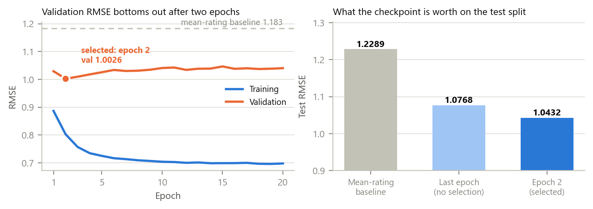
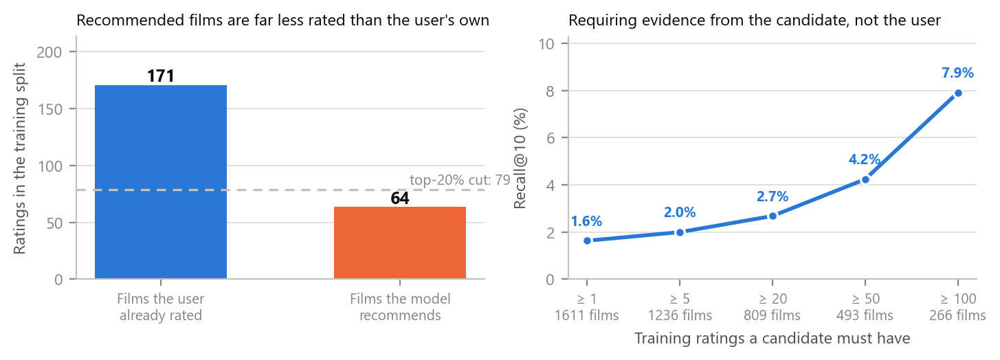
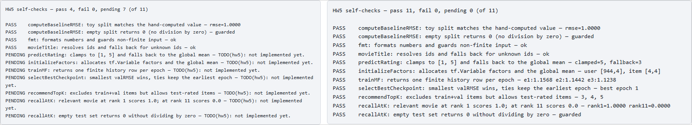

# Familiar Genre, Unfamiliar Title: What a 16-Factor Model Recommends When Almost Nobody Has Rated the Film

Student: Aleksei Kosychev &nbsp;&nbsp; Team: Individual 
Email: amkosychev@edu.hse.ru &nbsp;&nbsp; Date: 2026-10-12 
Assignment: A05 — From Ratings to Recommendations (Matrix Factorization), MovieLens 100k (Week 5)

## Abstract

The Week 5 starter is a TensorFlow.js page with six `TODO(hw5)` stubs: the factor variables, a batched
training loop, the scalar prediction, checkpoint selection, Top-10 retrieval and Recall@10. I implemented
all six; the page's own 11 self-checks pass, and an independent browser test adds 11 more. With the
hyper-parameters `index.html` ships with, the model reaches a **test RMSE of 1.0432 against a mean-rating
baseline of 1.2289** — 15.1% better — but **Recall@10 is only 1.63%**, and 91 of 861 evaluable users get a
single hit. The reason is visible in the lists themselves. They are **familiar in genre and unfamiliar in
title**: 6.6 of every 10 recommended films carry one of the user's three most-liked genres, yet the average
recommended film has **63.5 training ratings against 170.8 for the films the user already rated**, and for
**96.4% of users the whole Top-10 is less known than their own history**. The argmax over 1,611 candidates
systematically selects the films whose 16 factors are least constrained by data. Requiring a candidate to
carry at least 100 training ratings multiplies Recall@10 by **4.9×**, to 7.92%. Two departures from the
assignment's own code sketch were needed and are measured: its L2 term squares the whole factor matrices on
every mini-batch, which drives the factors to a norm of 1.7×10⁻¹⁹ and the model exactly back to the
baseline; and selecting a checkpoint without restoring it leaves 0.0336 RMSE on the table.

*Index Terms* — matrix factorization, TensorFlow.js, implicit evaluation, Recall@K, popularity bias, MovieLens

## 1. Introduction

**Problem statement.** The course provides a page whose scaffolding — the TensorFlow.js bootstrap, the RMSE
helpers, every renderer and an 11-check harness — is complete, and whose six algorithmic functions are
empty stubs [1]. The task is to build the user–movie matrix treating a missing rating as *unobserved rather
than zero*, split each user's ratings by timestamp 80/10/10, learn 16-dimensional user and movie vectors
whose dot product predicts a rating, select a checkpoint by validation RMSE, report test RMSE against a
mean-rating baseline, produce Top-10 lists for two users, and evaluate Recall@10 with test ratings ≥ 4.0 as
relevant. The single analysis question is whether those lists help users **discover** films or merely
**repeat** what they already like.

**Concrete example.** User 655 has rated 616 films; their favourites include *The Godfather*, *The
Fugitive* and *Belle de jour*, and their three most-liked genres are Drama, Thriller and Romance. The
Top-10 the trained model returns is led by *C'est arrivé près de chez vous* (3 training ratings), *Aiqing
wansui* (1), *Santa with Muscles* (2) and *Police Story 4* (1). Six of the ten do carry a top-three genre —
and not one of them has been rated by more than seven people in the training split.

**Contributions.** (i) The six stubs implemented with TensorFlow.js tensor operations, with a fixed seed so
that a re-run reproduces every number in this report. (ii) Two corrections to the assignment's own sketch —
a regulariser that penalises the rows a batch touches rather than the whole matrices, and a checkpoint that
is restored rather than merely named — each measured against the sketch's behaviour. (iii) An evaluation
run through the real page, including a prediction recomputed outside the browser, and an analysis of what
the Top-10 lists contain that answers the assignment's business question with numbers.

## 2. Related Work

Sources: the course starter [1]; MovieLens 100k and its documentation [2], [3]; Koren et al. for the
latent-factor model this implements [4]; Cremonesi et al. for the gap between squared-error accuracy and
top-N retrieval, which is exactly the gap measured here [5]; Smilkov et al. for the TensorFlow.js runtime
and its WebGL backend [6]; Kingma and Ba for Adam [7]; Prechelt for checkpoint selection on a validation
split [8].

**Alternatives considered.** *Biases per user and per movie* (`mu + b_u + b_i + p_u·q_i`) are the standard
next term in [4] and would cost two more variables, but §6 of the assignment defines the prediction as
`mu + p_u·q_i` and the self-checks encode that, so the bias terms stay out. *Ranking losses* (BPR, WARP)
optimise what Recall@10 measures instead of squared error; they are the principled fix for the retrieval
result in §4, not a variant of the specified model. *Implicit-feedback weighting* would treat the unobserved
entries as weak negatives rather than as missing — explicitly excluded by the assignment's "unobserved, not
zeros" rule.

## 3. Method

**Structures.** `data.js` is provided and unmodified: it parses `u.item` and `u.data`, builds the dense
`(943 + 1) × (1682 + 1)` matrix with `0` marking an unobserved pair, and splits each user's ratings by
ascending timestamp (ties broken by movie id) into 80 / 10 / 10. Only the ratings that exist are ever fed to
the optimizer — the zeros are never treated as training targets, which is what "missing, not zero" means in
practice. Both factor matrices are indexed by **raw id**, so row *k* belongs to user or movie *k*; this is
why `tf.topk` returns movie ids directly and no reverse mapping is needed anywhere.

**TensorFlow.js use.** The functions this implementation actually calls are `tf.variable`,
`tf.randomNormal(shape, mean, std, dtype, seed)`, `tf.gather`, `tf.tensor1d`, `tf.scalar`, `tf.mul`,
`tf.sum`, `tf.mean`, `tf.square`, `tf.topk`, `tf.losses.meanSquaredError`, `tf.train.adam`,
`optimizer.minimize(fn, returnCost, varList)`, `tf.tidy` and `tf.dispose`, plus the tensor methods
`slice`, `matMul`, `squeeze`, `clone`, `assign` and `dataSync`. `tf.train.sgd` is named in the stub
comments but is not used. Every rating in a mini-batch is scored by one `gather` + `mul` + `sum`; there is
no per-rating `tf` call anywhere. The browser reports the **WebGL** backend, so these are GPU timings.

**Two departures from the stub sketch, both measured in §4.**

1. *The regulariser.* The sketch adds `userFactors.square().sum() + itemFactors.square().sum()` times
   `reg` to **every mini-batch** loss. At the shipped `reg = 0.05` and 1,245 batches per epoch that is a
   weight decay three orders of magnitude stronger than the squared-error term it is meant to balance. I
   penalise only the rows the batch gathered, averaged like the loss itself.
2. *The checkpoint.* `selectBestCheckpoint` returns a history row; nothing in the scaffolding puts those
   weights back. Validation RMSE bottoms out at epoch 2 of 20, so a model left at the last epoch is not the
   model the selection chose. `trainMF` keeps a clone of the factors at the best epoch and `assign`s it back
   when the loop ends, in place, so the reported test RMSE, both Top-10 lists and Recall@10 all describe the
   same selected model.

**Reproducibility.** `tf.randomNormal` is seeded and the epoch shuffle uses a seeded mulberry32 generator
rather than `Math.random`, so two runs with the same hyper-parameters produce bit-identical curves — checked
in the test suite. Every number below comes from one such run.

**Tools.** Vanilla HTML/CSS/JS with TensorFlow.js 4.22.0 from a CDN, no build step; Python 3.12 with
Playwright 1.58 driving Google Chrome headless for the evaluation harness; Matplotlib 3.10 for the figures;
Claude Code with Claude Opus 5. Only `script.js` differs from the course files — `index.html`, `style.css`
and `data.js` are byte-identical to the starter.

## 4. Experiments

**Setup.** MovieLens 100k: 943 users × 1,682 movies, 100,000 ratings, a matrix 6.30% full (1,588,752 cells).
The per-user chronological split yields **79,619 train / 9,596 validation / 10,785 test** ratings and
excludes **no** users — every user has at least five ratings. 1,611 of the 1,682 movies appear in training,
so 71 can never be recommended from a training-only pool; 46 distinct movies in the test split are among
them. Training uses the page's shipped defaults: 16 factors, 20 epochs, Adam at lr 0.01, `reg` 0.05 and
batch 64 (1,245 optimizer steps per epoch).

**Result 1 — the model beats the baseline, and the checkpoint is worth a third of that gain.**

<em>Fig. 1. Left: training RMSE keeps falling while validation RMSE bottoms out at epoch 2 and then drifts
up — 18 of the 20 epochs are spent overfitting. Right: the test RMSE of the baseline, of the last epoch, and
of the checkpoint that was actually selected and restored.</em>

| | Train | Validation | Test |
|---|---|---|---|
| Mean-rating baseline (predict `mu` = 3.5806) | 1.1052 | 1.1830 | 1.2289 |
| Factorization, last epoch (epoch 20) | 0.6977 | 1.0403 | 1.0768 |
| **Factorization, selected checkpoint (epoch 2)** | **0.8027** | **1.0026** | **1.0432** |

The factorization beats the baseline by 0.1857 RMSE (15.1%). Of that, 0.0336 — 18% of the total gain —
comes from restoring epoch 2 rather than keeping epoch 20; the difference is measured in one run by
switching the snapshot off with an empty validation split, which leaves training otherwise identical.

**Result 2 — the lists are genre-familiar and title-obscure.** Recall@10 over the test split is **1.63%**,
averaged over the **861** users who have at least one relevant test film inside the training pool. The
evaluation excludes **82** users with no such film and **13** distinct relevant test films that never appear
in training. Only **91 of 861** users get a single hit in ten.

| Over the 861 evaluated users, per Top-10 list | |
|---|---|
| Films sharing one of the user's three most-liked genres | **6.6 of 10** (65.8%) |
| Films from a genre the user has never rated | 0.7 of 10 (7.2%) |
| Films in the top 20% by training popularity (≥ 79 ratings) | 2.4 of 10 (24.2%) |
| Mean training ratings: recommended film vs film the user rated | **63.5 vs 170.8** |
| Users whose whole list is less known than their own history | **96.4%** |
| Distinct films ever recommended / Gini of that distribution | 746 of 1,611 (46.3%) / 0.867 |

<em>Fig. 2. Left: the average film the model recommends has been rated by a third as many people as the
average film the user themselves rated. Right: Recall@10 when a candidate must carry a minimum number of
training ratings; the number of surviving candidates is printed under each point.</em>

Restricting candidates to films with at least 100 training ratings — 266 of 1,611 — raises Recall@10 from
1.63% to **7.92%** while the mean popularity of a recommendation rises from 63.5 to 182.7 and the familiar
share from 65.8% to 75.6%. Nothing about the model changes across that sweep; only which films are allowed
to be ranked.

**Result 3 — the sketch's regulariser deletes the model.** Holding everything else equal (10 epochs, batch
1024), the two penalties give:

| L2 term | Mean item-factor norm | Validation RMSE | Test RMSE |
|---|---|---|---|
| Rows gathered by the batch (this implementation) | 1.015 | 0.9741 | **1.0144** |
| Whole factor matrices, as sketched in the readme | **1.7×10⁻¹⁹** | 1.1830 | 1.2289002 |

The second row is not an approximation of the baseline — it *is* the baseline: 1.2289002 against the
mean-rating baseline's 1.2289001. With the factors annihilated, `mu + p·q` reduces to `mu`.

**Result 4 — batch size trades wall-clock against progress per epoch.**

| Batch | Optimizer steps per epoch | Seconds per epoch (WebGL) | Validation RMSE after 1 epoch |
|---|---|---|---|
| 64 (shipped default) | 1,245 | 14.1 | 1.0292 |
| 256 | 312 | 5.8 | 1.0491 |
| 1,024 | 78 | 1.4 | 1.1742 |

Wall-clock varies by machine and GPU scheduling — the four full runs recorded here spent 152 s, 222 s,
382 s and 383 s on the same 20 epochs, while every RMSE they produced was identical to the last decimal — so
the step count is the stable figure. A smaller batch buys more progress per epoch at proportionally more time.

**Verification.** `tests/check_mf.py` drives the real page and runs 11 checks, all passing, on top of the
page's own 11: the split is exactly 80/10/10 for all 943 users with training strictly before test; two runs
with the same hyper-parameters give identical curves; three consecutive runs hold the live tensor count at
27, so nothing leaks; after training, `computeRMSEFor(valSet)` equals the selected checkpoint's validation
RMSE to 10⁻⁶, which is what proves the restore happened; 40 Top-10 lists contain no film the user rated in
training or validation and are sorted; and Recall@10's bookkeeping closes — 861 reported + 82 excluded = 943
test users. One prediction was recomputed outside the browser: for the first test rating (user 196, movie
411, stored rating 4) the page returns **3.291459**, and the dot product of the two exported 16-element
factor rows, −0.289143, plus `mu` = 3.580603 gives **3.291459** in Python — agreement 4.1×10⁻¹⁰, and a
squared error of 0.502030 against the stored rating. The test suite repeats the same check independently on
its own shorter run.

<em>Fig. 3. The page's own harness, before and after. Left: the untouched starter reports 4 passed and 7
pending — the four provided helpers pass, the seven stub-backed checks cannot run. Right: with the six stubs
implemented it reports 11 passed, 0 pending.</em>

## 5. Discussion

**Familiar choices vs. new discoveries — the assignment's question.** Both of the showcased users get lists
that **stay inside their taste but leave the catalogue they know**. User 655 (616 ratings; Drama, Thriller,
Romance) receives six Drama/Thriller/Romance titles out of ten, none rated by more than seven people. User
55 (18 ratings; Action, Adventure, War) receives *Paradise Lost*, *Bad Taste* and *The Killing Fields* — two
of ten in a top-three genre, one film from a genre they have never rated. Aggregated over 861 users the
pattern is unambiguous: 65.8% genre-familiar, 7.2% genre-new, and 96.4% of users handed a list that is on
average less known than their own viewing history.

So the answer is neither "repeats" nor "discovers": the model **repeats the genre and randomises the
title**. That is a predictable consequence of the objective. A film with three ratings contributes three
squared-error terms, so its 16 factors stay close to their random initialisation; a ranking that takes the
maximum over 1,611 candidates is therefore biased towards exactly those films, because an unconstrained
vector is free to point wherever the user's vector points. Recall@10 of 1.63% is the same fact measured
against ground truth, and it is the gap Cremonesi et al. describe between error metrics and top-N tasks [5].

For a streaming platform that is the worst of both worlds. The list is not reassuring — a subscriber who
liked *The Godfather* is shown *Santa with Muscles* — and it is not trustworthy discovery either, because
the model has no evidence about those titles at all. It would not survive contact with a homepage. The
cheapest fix is an evidence floor on the candidate rather than a better model: at ≥ 100 training ratings
recall is 4.9× higher. But that floor is itself the trade-off the question is about — it buys relevance by
making the lists more familiar (75.6% in a top-three genre) and more mainstream (182.7 mean ratings), which
is the opposite of discovery. Genuine discovery needs a stated novelty objective and a budget of slots to
spend on it, not a squared-error model and a hope.

**Failure case and root cause.** Starting from the stub sketch verbatim gives a model that is *exactly* the
mean-rating baseline, and silently so: the page trains, the curve renders, and the RMSE simply never
improves. The cause is that a per-batch penalty on the entire parameter matrix scales with the number of
batches, not with the data in the batch; at 1,245 batches per epoch it wins against the loss by three orders
of magnitude.

**What worked.** Seeding both random sources first. Every later comparison — checkpoint vs last epoch,
regulariser vs regulariser, batch size vs batch size — is a one-variable experiment only because the rest of
the run is bit-identical, and the test suite can assert that as a property rather than hoping for it.

**What surprised me.** That the shipped defaults are not the best configuration on either metric: the same
code at batch 1,024 for 10 epochs reaches validation RMSE 0.9741, test RMSE 1.0144 and **Recall@10 of
3.72%** — against 1.0026, 1.0432 and 1.63% — in 15 seconds instead of 152. Twenty epochs at batch 64 spends
18 of them moving away from the checkpoint it will eventually restore, and the extra fitting lands hardest
on exactly the thinly-rated films that then win the argmax.

**A defect I did not fix.** `data.js` reads `u.item` with `Response.text()`, which decodes as UTF-8, while
the file is ISO-8859-1; **9 of the 1,682 titles** are corrupted, including the top recommendation for user
655, *C'est arrivé près de chez vous*. The submission instructions list `data.js` as provided and not to be
modified, so it is unmodified here; the one-line fix is to read `arrayBuffer()` and decode with
`new TextDecoder('iso-8859-1')`.

**Next improvement.** Add per-user and per-movie bias terms [4]. Half of the remaining squared error is
users and films disagreeing about where the middle of the scale is, and biases absorb that with 2,627 extra
parameters instead of asking 16-dimensional vectors to encode it.

## 6. AI Usage Disclosure

**AI tools used.** Claude Code (VS Code extension), model Claude Opus 5, one session.

**How AI was used.** *Search / reading:* cloning [1] and reading `week5/`; checking each TensorFlow.js
signature against the library before use. *Code generation:* the six `TODO(hw5)` implementations in
`script.js`, `experiments/run_experiment.py`, `experiments/make_figures.py` and `tests/check_mf.py`.
*Analysis:* running the evaluation and drafting this report.

**What I personally verified.**

TODO (to be completed before submission): serve <code>hw5/</code> with <code>python -m http.server</code>,
open <code>starter/index.html</code> and confirm "Run tests" reports 4 passed / 7 pending; open
<code>index.html</code>, confirm 11 passed / 0 pending, press Train with the shipped defaults and confirm the
status line names epoch 2, then reproduce the user 655 Top-10 of §5 and the Recall@10 panel; re-run
<code>tests/check_mf.py</code> and confirm 11/11.

**What I trusted without verification.** That `tf.randomNormal`'s seed is honoured identically by the WebGL
backend on other machines — it is reproducible on this one, which is all the test asserts; and that the
MovieLens timestamps order each user's ratings correctly, since the whole split rests on them.

**Session log.** `kosychev_a05_session.json` is the unmodified Claude Code log of this work.

## References

[1] S. Jin, "RecSys-LLMs: Recommender Systems course repository (week5)," GitHub, commit `a4f53be`, 2026. [Online]. Available: https://github.com/dryjins/RecSys-LLMs/tree/main/week5. [Accessed: 2026-10-12].

[2] F. M. Harper and J. A. Konstan, "The MovieLens Datasets: History and Context," *ACM Trans. Interact. Intell. Syst.*, vol. 5, no. 4, pp. 1–19, 2015.

[3] GroupLens Research, "MovieLens 100K Dataset," University of Minnesota. [Online]. Available: https://grouplens.org/datasets/movielens/100k/. [Accessed: 2026-10-12].

[4] Y. Koren, R. Bell, and C. Volinsky, "Matrix Factorization Techniques for Recommender Systems," *Computer*, vol. 42, no. 8, pp. 30–37, 2009.

[5] P. Cremonesi, Y. Koren, and R. Turrin, "Performance of Recommender Algorithms on Top-N Recommendation Tasks," in *Proc. 4th ACM Conf. Recommender Systems (RecSys)*, 2010, pp. 39–46.

[6] D. Smilkov et al., "TensorFlow.js: Machine Learning for the Web and Beyond," in *Proc. Machine Learning and Systems (MLSys)*, vol. 1, 2019, pp. 309–321.

[7] D. P. Kingma and J. Ba, "Adam: A Method for Stochastic Optimization," in *Proc. 3rd Int. Conf. Learning Representations (ICLR)*, 2015.

[8] L. Prechelt, "Early Stopping — But When?," in *Neural Networks: Tricks of the Trade*, LNCS 1524, Springer, 1998, pp. 55–69.
