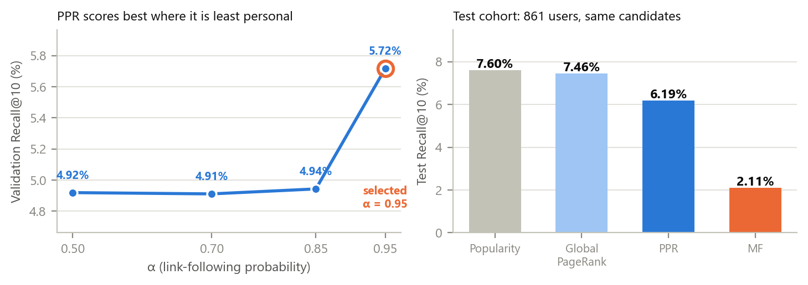
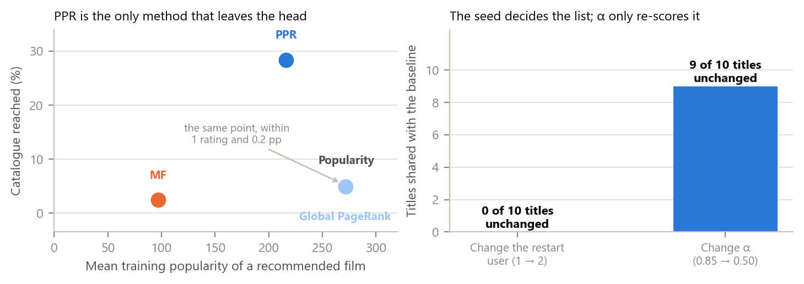
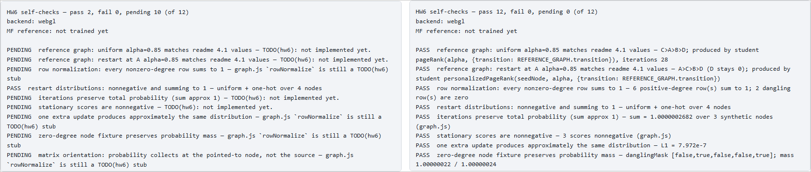

# Personal but Not Better: Personalized PageRank Against a Popularity List on a MovieLens Rating Graph

Student: Aleksei Kosychev &nbsp;&nbsp; Team: Individual 
Email: amkosychev@edu.hse.ru &nbsp;&nbsp; Date: 2026-10-21 
Assignment: A06 — Graph-Based Recommendations with Personalized PageRank, MovieLens 100k (Week 6)

## Abstract

The Week 6 starter leaves seven `TODO(hw6)` stubs: the bipartite graph, the row-normalized transition,
global PageRank, Personalized PageRank, movie-node extraction, Top-10 retrieval and Recall@10. I
implemented all seven on TensorFlow.js tensors; the page's own 12 self-checks pass, including both
reference vectors of readme §4.1 to within 1.7×10⁻⁷, and an independent browser test adds 14 more. On the
shared cohort of **861 test users** with identical candidates and exclusions, **a non-personalised
most-rated list wins: Recall@10 of 7.60%, against 7.46% for global PageRank, 6.19% for PPR and 2.11% for
the provided MF reference.** Two measurements explain that ordering. First, global PageRank on a
bipartite rating graph *is* a popularity list: its recommendations average 271.3 training ratings against
popularity's 272.0, and it reaches 4.9% of the catalogue against 5.1% — the two methods are the same point.
Second, validation selects **α = 0.95**, the value at which the walk strays furthest from its seed, so the
tuning objective rewards PPR for being *less* personal. PPR is nevertheless the only method that leaves the
head of the catalogue: 28.4% of titles reached, against 5.1%, 4.9% and 2.4%. A one-factor-at-a-time
demonstration separates the two knobs cleanly — changing the restart user replaces **10 of 10** titles,
changing α from 0.85 to 0.50 replaces **1 of 10**. The MF column is reported but should not be read as
matrix factorization: the provided reference's RMSE is identical at all 30 epochs and it assigns **one
single score** to all 1,611 candidates.

*Index Terms* — Personalized PageRank, random walk, bipartite graph, popularity bias, Recall@K, TensorFlow.js

## 1. Introduction

**Problem statement.** The course provides a page whose scaffolding — data layer, d3 graph view, MF
reference, exporters and a 12-check harness — is complete, and whose seven graph functions are empty
stubs [1]. The task is to build a user–movie graph from training ratings ≥ 4.0, treat a missing rating as
unobserved, compute global PageRank and user-seeded PPR with TensorFlow.js, verify normalization,
probability conservation, convergence and zero-degree handling, select α on validation Recall@10, and
compare popularity, global PageRank, PPR and the previous assignment's MF on one shared cohort. The single
business question is whether a streaming platform should keep MF, replace it with PPR, or run both in
different sections.

**Concrete example.** User 1 (131 positive training edges; Drama 61, Comedy 39, Action 36) is seeded at
α = 0.85 and PPR returns Fargo, The English Patient, Sense and Sensibility — films with 377, 279 and 178
training ratings. Seeding user 2 instead (32 edges, Drama 18, Comedy 11, Romance 11) returns Cop Land,
Mother and The Apostle, with 70, 52 and 29 ratings, and **not one title in common**. Changing α instead of
the seed leaves nine of the ten titles exactly where they were.

**Contributions.** (i) The seven stubs implemented with tensor propagation over the two off-diagonal blocks
of the transition, never materializing the 2,554 × 2,554 matrix. (ii) A memoised all-seeds batch that
solves every user's walk in one pass — 7.6 ms per user against 455 ms — verified against the single-seed
path to 3.7×10⁻⁹. (iii) An evaluation on one shared cohort with every exclusion reported, plus the three
machine-readable exports readme §9 requires. (iv) Evidence that two of the four compared methods are not
what their names suggest: global PageRank is a popularity ranking here, and the provided MF reference never
left its initialization.

## 2. Related Work

Sources: the course starter [1]; MovieLens 100k [2], [3]; Page et al. for PageRank and the damping
factor [4]; Haveliwala for a restart distribution that is not uniform [5]; Jeh and Widom for personalized
PageRank at scale [6]; Eksombatchai et al. for a random-walk recommender actually deployed on a bipartite
graph [7]; Cremonesi et al. for the popularity baseline that any top-N method has to beat [8]; Smilkov
et al. for TensorFlow.js and its WebGL backend [9].

**Alternatives considered.** *Weighting edges by rating value* would turn the 4-or-5 binary edge into a
graded one; readme §3.1 defines `R` as an indicator, so the graph stays unweighted. *Precomputing the full
PPR matrix offline* is what a production system does [6], [7]; the all-seeds batch here is the same idea
inside one page load. *Pruning low-degree movies from the candidate pool* would raise every method's recall,
as A03 showed, but readme §5 fixes the pool at all training movies, so it is reported rather than applied.

## 3. Method

**Graph.** Nodes are every user id and every movie id observed in the training split — 943 + 1,611 = 2,554,
with no padding node — ordered users first. An edge exists in both directions iff the user rated the movie
≥ 4.0 in training, giving 45,602 positive edges, a bipartite density of 3.00%. A zero in `R` is the absence
of a positive edge, not a dislike; the training split contains ratings below 4.0 whose movies are still
nodes, which is why **1 user and 253 movies have degree 0**.

**Transition and zero-degree policy.** Each positive-degree row is divided by its degree; zero-degree rows
stay all-zero and are marked in `danglingMask`. The update is
`p_next = α (Qᵀ p + d v) + (1 − α) v`, where `d` is the mass currently on zero-degree nodes, so that mass
restarts instead of leaking. The same rule runs in global PageRank (uniform `v`) and PPR (one-hot `v`);
`p` starts at `v`, and iteration stops when the L1 difference falls below 10⁻⁶ or after 500 steps, with
`converged` false if the cap is reached.

**TensorFlow.js use.** The square matrix is never built. `R` is uploaded once per graph as a
`[943 × 1,611]` tensor and the two blocks are applied as `tf.matMul(R, pMovie · invDegMovie)` and
`tf.matMul(R, pUser · invDegUser, true, false)`; the dangling mass is a `tf.sum` over the masked vectors.
Each step runs inside `tf.tidy`, the iterate is disposed explicitly, and the cached tensors are released
when the graph is replaced — three consecutive propagations leave the live tensor count unchanged at 5.
The readme's 4-node reference fixture takes a different path on purpose: it is propagated in float64
JavaScript, which §3.5 permits for small fixtures and which matters because the reference vectors are
quoted to ten decimals while TensorFlow.js tensors are float32.

**The all-seeds batch.** Every evaluation sweeps the same graph at the same α over hundreds of restart
users, and those columns are independent. The first PPR call for a `(graph, α)` pair therefore solves all
943 seeds at once — the restart matrix is the identity — and later calls read their column. Measured:
**7.6 ms per user against 455 ms** one at a time, with a maximum absolute difference of **3.7×10⁻⁹**
against the single-seed path, which the test asserts. Convergence is tracked per column, so a user's
reported iteration count is the step at which *their* residual crossed the tolerance.

**Tools.** Vanilla HTML/CSS/JS with TensorFlow.js 4.22.0 and a vendored d3 v7; Python 3.12 with
Playwright 1.58 driving Google Chrome headless (WebGL backend) for the evaluation harness; Matplotlib 3.10
for the figures; Claude Code with Claude Opus 5. Only `graph.js` and `script.js` differ from the course
files — `index.html`, `style.css`, `data.js` and `vendor/d3.min.js` are byte-identical to the starter.

## 4. Experiments

**Setup.** MovieLens 100k, the same files and the same per-user chronological 80/10/10 split as A05:
79,619 training, 9,596 validation and 10,785 test ratings over 943 users and 1,682 movies, a matrix 6.30%
full. The shared test cohort is **861 users**; 82 users are excluded for having no eligible relevant test
film and 13 relevant films are excluded for never appearing in training. The same cohort rule without the
"at least one positive training edge" condition also yields 861 users, which is why the A05 MF number below
is directly comparable. The split is chronological **within** each user, not globally, and MovieLens
records rating times rather than viewing sessions — neither method here can speak to session intent.

**Result 1 — α is selected where PPR is least personal.**

<em>Fig. 1. Left: validation Recall@10 across the α grid, over 846 users. Right: test Recall@10 for the
four methods on one shared cohort with identical candidates and exclusions.</em>

Validation Recall@10 is flat at 4.91–4.94% for α ∈ {0.50, 0.70, 0.85} and jumps to **5.72% at α = 0.95**,
which is therefore selected and used for both PPR and, as a disclosed control, global PageRank. A larger α
means the walk follows more links before restarting, so the distribution drifts away from the seed and
towards the graph's stationary mass. The selection rule rewards exactly that drift.

**Result 2 — the ranking of the four methods, and what two of them really are.**

| Method | Test Recall@10 | Mean training popularity | Catalogue reached | Zero-score items |
|---|---|---|---|---|
| Popularity | **7.60%** | 272.0 | 5.1% | 0 |
| Global PageRank (α = 0.95) | 7.46% | 271.3 | 4.9% | 0 |
| PPR (α = 0.95) | 6.19% | 216.1 | **28.4%** | 10 of 8,610 |
| MF — provided reference | 2.11% | 96.8 | 2.4% | 0 |
| *MF — A05 model, same protocol* | *1.63% / 3.72%* | — | — | — |

Global PageRank and popularity are the same point to within one rating and 0.2 percentage points
(Fig. 2, left). That is not a coincidence: on an undirected bipartite graph the stationary distribution of
a degree-normalized walk is proportional to degree, and a movie's degree here *is* the number of users who
rated it ≥ 4.0. Running a 243-iteration power method to reproduce a `GROUP BY` is a real cost with no
return. PPR is the only method whose lists leave the head, reaching 28.4% of the 1,611 candidates against
5.1%, and it almost never has to pad with unreachable films (10 zero-score entries in 8,610).

The MF row is reported because the comparison asks for it, but it is **not** matrix factorization. The
provided reference's training and validation RMSE are identical at all 30 epochs — 1.1052085111847403 and
1.1829947287151048, to the last digit — its factor norms are 3.6×10⁻⁵, and `mfScores` returns **one
distinct value, 3.5806, for all 1,611 candidates**: the global mean. Its "ranking" is the ascending-movie-id
tie-break. The italic row is my own A05 model on this same cohort and protocol: 1.63% with the hyper-
parameters A05's page shipped, 3.72% with the better configuration A05 identified. Even that trained model
is below PPR.

<em>Fig. 2. Left: how well known a recommended film is, against how much of the catalogue a method
reaches. Right: the one-factor-at-a-time demonstration on users 1 and 2.</em>

**Result 3 — one factor at a time.** Baseline: user 1 at α = 0.85. Changing **only the restart user** to
user 2 leaves **0 of 10** titles in place. Changing **only α**, to 0.50 for the same user 1, leaves **9 of
10** — the single swap is *A Time to Kill* (113 ratings) for *Kolya* (78). The restart seed decides which
films appear; α mostly rescales what is already there. User 2's list also shows where the walk runs out of
local structure: its first five entries score ≈ 2.8×10⁻² and have 16–70 training ratings, then rank 6 drops
an order of magnitude to 2.3×10⁻³ and the familiar blockbusters appear (Return of the Jedi, 339 ratings;
Raiders of the Lost Ark, 312). With only 32 positive edges, user 2's neighbourhood is exhausted after five
recommendations.

**Verification.** The page's 12 self-checks pass (Fig. 3) and `tests/check_ppr.py` adds 14, all passing.
Both readme §4.1 reference vectors are reproduced: maximum absolute deviation **1.7×10⁻⁷** for the uniform
restart (28 iterations) and **8.3×10⁻⁸** for the restart at A (30 iterations), with node D at exactly
0.037500 under uniform restart and 0.000000 under restart at A — a node nothing points to keeps only its
restart share. Probability is conserved to 2×10⁻⁷ including when the zero-degree user 685 is used as the
seed; all scores are nonnegative; at α = 0.95 global PageRank converged in 243 iterations with residual
9.65×10⁻⁷ and the seeded walk in 280 with 8.15×10⁻⁸, both inside the 500-step cap. One propagation step was
also recomputed by hand on the reference fixture: from the uniform `p₀ = [¼, ¼, ¼, ¼]`, the first update
gives `[0.25, 0.14375, 0.56875, 0.0375]`, which the page reproduces exactly. The exporters produce
`verification.json` (12 checks), `results.csv` (11 rows: four test methods, the four-point α sweep and the
convergence records) and `recommendations.csv` (30 rows).

<em>Fig. 3. The page's own harness before and after: the untouched starter reports 2 passed / 10 pending,
the submitted files report 12 passed / 0 pending.</em>

## 5. Discussion

**Keep MF, replace it with PPR, or run both? — Use both, in named sections, and retire MF as it stands.**

The evidence points three ways at once, so the answer has to separate the jobs rather than pick a winner.

*The main rail should not be PPR.* On the 861-user cohort PPR retrieves 6.19% of the relevant test films
against popularity's 7.60% — 19% worse — and it costs a 280-iteration power method per request where
popularity costs a counter. A platform that replaces its main rail with PPR pays more and retrieves less.
Global PageRank is worse than useless here: it returns the popularity list (271.3 vs 272.0 mean ratings,
4.9% vs 5.1% coverage) after 243 iterations, so it should not be shipped at all.

*But the main rail cannot be the whole page.* Popularity reaches 5.1% of the catalogue; across 861 users it
keeps recommending the same ~82 films. PPR reaches 28.4%, and does so without falling into the obscurity
trap A05 documented — its mean recommended film still has 216 training ratings, against 97 for the MF
column. The two users' lists show the mechanism: user 1, a Drama/Comedy/Action rater, is sent Fargo and
The English Patient (Crime/Drama and Drama/Romance, 377 and 279 ratings) — recognisable films that a
popularity rail would also surface but that arrive here *because of* his neighbours; user 2 is sent Cop
Land, Mother and The Apostle (70, 52, 29 ratings), which no popularity rail would ever show. That is the
section PPR earns: a "because people who liked what you liked also watched…" rail, where the job is
catalogue circulation rather than hit rate, and where 0-of-10 overlap between two users is the product
feature, not a metric.

*MF, as the course scaffolding ships it, earns nothing* — it predicts one number for every film. My own A05
model does train, and still reaches only 3.72% on this cohort, so the honest statement is that a
rating-RMSE model is the weakest of the three live options for top-10 retrieval, which is the gap
Cremonesi et al. describe [8]. Keep it for rating prediction if that is shown anywhere; do not give it a
rail.

**What these offline results cannot establish.** Recall@10 on a chronological split measures whether a
film the user later rated ≥ 4.0 appears in ten slots. It says nothing about current-session intent, about
whether the title was watched to completion, or about retention and revenue — and because the split is
chronological per user rather than globally, a "future" film for one user is a "past" film for another.
Catalogue coverage is an inventory statistic, not evidence that wider lists are better for anyone.

**Proposed online experiment before any rollout.** *Intervention:* on the logged-in home screen, add one
PPR rail ("Because viewers like you watched…") below the existing popularity rail, seeded at the user's own
node with α = 0.95; control sees the current page. *Primary outcome:* plays started from the home screen
per active user per week. *Guardrails:* total weekly viewing hours per user (the new rail must not simply
cannibalise the popularity rail) and 7-day retention. *Assignment:* randomise by stable user id hash, not
by session or device, so a returning user always sees the same arm and cross-arm contamination through
shared accounts is at least measurable; run until the primary outcome's confidence interval excludes a 1%
relative change.

**Failure case and root cause.** Selecting α on Recall@10 drives the method away from personalisation,
because the metric rewards retrieving films the user later rated — and the films people rate are
disproportionately popular. The flat 4.91–4.94% region followed by the jump at 0.95 is that pressure made
visible. A recommender tuned on this metric will keep rediscovering the popularity list.

**What worked.** Building the transition from `R` and `Rᵀ` instead of a square matrix, then batching every
seed into one pass. The square matrix would have been 2,554² entries; the batch turned a 40-minute α sweep
into 35 seconds, and asserting it against the single-seed path made the optimisation safe to trust.

**What surprised me.** That global PageRank on this graph is popularity with extra steps — obvious once the
degree argument is written down, but not before measuring it. And that the provided MF reference never
trained: its RMSE is bit-identical across 30 epochs, which is the same regularizer defect A05 diagnosed.

**Next improvement.** Seed the walk on the user's *recent* positive ratings rather than the user node
itself, with weights decaying by age. The current restart vector treats a film rated two years ago exactly
like one rated last week, and the per-user score cliff in user 2's list suggests the walk needs more
restart mass in the right place rather than a larger α.

## 6. AI Usage Disclosure

**AI tools used.** Claude Code (VS Code extension), model Claude Opus 5, one session.

**How AI was used.** *Search / reading:* cloning [1] and reading `week6/`; checking each TensorFlow.js
signature before use. *Code generation:* the seven `TODO(hw6)` implementations in `graph.js` and
`script.js`, `experiments/run_experiment.py`, `experiments/make_figures.py` and `tests/check_ppr.py`.
*Analysis:* running the evaluation and drafting this report.

**What I personally verified.**

TODO (to be completed before submission): serve <code>hw6/</code> with <code>python -m http.server</code>,
open <code>starter/index.html</code> and confirm "Run self-checks" reports 2 passed / 10 pending; open
<code>index.html</code>, press Build graph and confirm 2,554 nodes, then Run self-checks for 12 passed / 0
pending; run the α sweep and confirm it selects 0.95; run the comparison and the two-user demonstration and
confirm the Recall@10 values and the 0-of-10 / 9-of-10 overlaps of §4; re-run
<code>tests/check_ppr.py</code> and confirm 14/14.

**What I trusted without verification.** That the course's `data.js` splits each user's ratings exactly as
A05 did (the two cohort counts agree, which is consistent but not a proof of record-level identity); and
that the WebGL backend's float32 matMul is accurate enough for the MovieLens walk — the readme §4.1 fixture
is checked in float64, and the MovieLens runs are only checked for mass conservation and stability.

**Session log.** `kosychev_a06_session.json` is the unmodified Claude Code log of this work.

## References

[1] S. Jin, "RecSys-LLMs: Recommender Systems course repository (week6)," GitHub, commit `00c032f`, 2026. [Online]. Available: https://github.com/dryjins/RecSys-LLMs/tree/main/week6. [Accessed: 2026-10-21].

[2] F. M. Harper and J. A. Konstan, "The MovieLens Datasets: History and Context," *ACM Trans. Interact. Intell. Syst.*, vol. 5, no. 4, pp. 1–19, 2015.

[3] GroupLens Research, "MovieLens 100K Dataset," University of Minnesota. [Online]. Available: https://grouplens.org/datasets/movielens/100k/. [Accessed: 2026-10-21].

[4] L. Page, S. Brin, R. Motwani, and T. Winograd, "The PageRank Citation Ranking: Bringing Order to the Web," Stanford InfoLab, Technical Report 1999-66, 1999.

[5] T. H. Haveliwala, "Topic-Sensitive PageRank," in *Proc. 11th Int. Conf. World Wide Web (WWW)*, 2002, pp. 517–526.

[6] G. Jeh and J. Widom, "Scaling Personalized Web Search," in *Proc. 12th Int. Conf. World Wide Web (WWW)*, 2003, pp. 271–279.

[7] C. Eksombatchai et al., "Pixie: A System for Recommending 3+ Billion Items to 200+ Million Users in Real-Time," in *Proc. World Wide Web Conf. (WWW)*, 2018, pp. 1775–1784.

[8] P. Cremonesi, Y. Koren, and R. Turrin, "Performance of Recommender Algorithms on Top-N Recommendation Tasks," in *Proc. 4th ACM Conf. Recommender Systems (RecSys)*, 2010, pp. 39–46.

[9] D. Smilkov et al., "TensorFlow.js: Machine Learning for the Web and Beyond," in *Proc. Machine Learning and Systems (MLSys)*, vol. 1, 2019, pp. 309–321.
